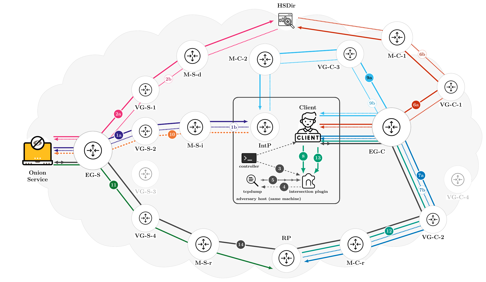

# Deanonymizing Onion Services Through Long-Lived Introduction Circuits

This repository is the artifact for the paper *The Cost of Stability:
Deanonymizing Onion Services Through Long-Lived Introduction Circuits*
(Financial Cryptography 2027). It contains:

- a **modified Tor daemon** that lets the operator of an onion service pin the
  service's introduction circuit to four chosen relays;
- the **intersection plugin** and the **automation scripts** that run the
  attack against that self-operated onion service;
- a script that **measures the introduction-handshake latency** of onion
  services.

The experiment is meant to be run only against an onion service and relays
that you operate yourself.

---

## How the setup works

### What the attack does

An onion service keeps a long-lived *introduction circuit* to each of its
Introduction Points:

```
onion service -> entry guard -> layer-2 vanguard -> middle relay -> Introduction Point
```

Every time a client asks the Introduction Point to contact the service, the
request travels over this same circuit. The attack uses that fact to find the
circuit one relay at a time, starting from the Introduction Point, which is
public. It runs in four **stages**, one per relay:

| Stage | Relay being observed | Relay the stage identifies |
|---|---|---|
| 0 | Introduction Point | middle relay |
| 1 | middle relay | layer-2 vanguard |
| 2 | layer-2 vanguard | entry guard |
| 3 | entry guard | the onion service itself |

Each stage repeats the same **iteration** until one candidate is left:

1. The adversary's client triggers one introduction handshake with the
   service.
2. While that handshake is in progress, the adversary records every
   destination IP address the observed relay sends packets to. This is the
   *anonymity set* of the iteration. The next relay of the circuit must be in
   it, because the introduction request had to be forwarded to it.
3. The adversary intersects this set with the sets of all previous iterations.
   The next relay is in every set, while unrelated destinations come and go,
   so the intersection shrinks.
4. When a single address remains, it is the next relay. The adversary moves
   its observation there and starts the next stage.

### The controlled setup

In the paper's threat model the adversary watches a relay's traffic from the
network (for example at the relay's ISP). We cannot do that, so we run the
experiment on relays that we operate ourselves and observe the traffic on the
relay's own host. The onion service is also ours, and its introduction circuit
is pinned to our four relays, so the attack only ever targets our own circuit
and we know the correct answer for every stage.



The box in the middle of the figure is the host of the relay currently being
observed (the Introduction Point at stage 0). Four components run on it:

| Component | File | What it does |
|---|---|---|
| Controller | `packet_logger_scripts/*/runner.sh` | Starts the plugin, launches one probe client per iteration, and starts the next stage on the next relay. |
| Probe client | the modified Tor daemon | Connects to the onion service, which triggers one introduction handshake, and tells the plugin when the handshake starts and ends. |
| Intersection plugin | `packet_logger_scripts/packet_processer.py` | Builds the anonymity set of each iteration and keeps the running intersection. |
| `tcpdump` | system package | Captures the headers of the packets the relay sends. Started by the plugin. |

A fifth component, the onion service (also the modified Tor daemon), runs on a
separate machine.

Running the client on the same host as the relay does not shortcut Tor: the
client still reaches the Introduction Point through a normal Tor circuit, and
the introduction request still crosses the full pinned circuit to the service.
Sharing the host only makes it easy to tell the plugin exactly when a
handshake starts and ends, without having to synchronize clocks.

### Step by step

The numbers match the numbered arrows in the figure.

**Service setup (once)**

- **1a, 1b** — The onion service builds its introduction circuit through the
  four pinned relays and the Introduction Point confirms it.
- **2a, 2b** — The service publishes its descriptor, so any client can find
  the Introduction Point.

**Start of each stage**

- **3** — The controller starts the intersection plugin on the observed relay.
- **4** — The plugin starts `tcpdump`.
- **5** — `tcpdump` streams packet headers to the plugin through a pipe.
  Nothing is written to a capture file.

**Each iteration**

- **6a, 6b** — The controller launches a fresh probe client, which downloads
  the service descriptor.
- **7a, 7b** — The client sets up a rendezvous point.
- **8** — The client sends `start` to the plugin, immediately before sending
  its introduction request. The plugin begins collecting destination
  addresses.
- **9a, 9b** — The client sends `INTRODUCE1` to the Introduction Point, which
  acknowledges it.
- **10** — The Introduction Point forwards the request to the service as
  `INTRODUCE2` over the pinned circuit. This is the traffic the attack looks
  for.
- **11** — The service connects to the rendezvous point (`RENDEZVOUS1`).
- **12** — The rendezvous point notifies the client (`RENDEZVOUS2`).
- **13** — The client sends `stop` to the plugin. The plugin closes the
  anonymity set, removes the previous relay of the circuit from it (see
  `EXCLUDED_IPS` below), intersects it with the earlier sets, and writes the
  size of the intersection to a CSV file.
- **14** — The service answers the request. This happens after `stop` and is
  not observed.

The controller then stops the client, waits 30 seconds, and starts the next
iteration with a new client.

**End of a stage**

When the intersection contains a single address, the plugin exits. The
controller then connects over SSH to the next relay of the circuit and starts
the same procedure there. After the fourth relay (the entry guard) the run is
complete.

### What the plugin stores

- Destination addresses are handled only inside the `start`–`stop` window.
- Each address is immediately replaced by a pseudonym, using a key that is
  generated when the plugin starts and never leaves memory. Each stage runs a
  new plugin process, so each stage has a new key.
- Only the **size** of the intersection is written to disk, one row per
  iteration, together with public metadata of the observed relay taken from
  Onionoo (consensus weight, selection probabilities, bandwidth).
- No addresses, pseudonyms, packet timestamps, or packet contents are stored.

### Ground truth

Because the circuit is pinned, the correct next relay is known in advance
(`TARGET_IP`). The plugin uses it only as a check: if the correct relay is
ever missing from the intersection, it writes `FAIL` and stops. It is never
used to remove candidates or to decide that a stage has finished.

---

## Running the experiment

### Requirements

- Four Tor relays that you operate and that are active on the live network,
  with SSH access from each relay to the next one in the circuit.
- A machine for the onion service.
- On every relay: Python 3, `tcpdump`, `curl`, and the Python package
  `pycryptodomex`.

### Step 1: Pin the introduction circuit to your relays

1. Find your relays on Tor Metrics: https://metrics.torproject.org/rs.html
2. For each relay, copy its `Nickname` and `Fingerprint`.
3. Open `src/feature/hs/hs_experiment.h` and fill in:

   | Fields | Relay |
   |---|---|
   | `FORCED_INTRO_FP_HEX`, `FORCED_INTRO_NICK` | Introduction Point |
   | `FORCED_MID_FP_HEX`, `FORCED_MID_NICK` | middle relay |
   | `FORCED_VANGUARD_FP_HEX`, `FORCED_VANGUARD_NICK` | layer-2 vanguard |
   | `FORCED_ENTRY_FP_HEX`, `FORCED_ENTRY_NICK` | entry guard |

### Step 2: Build the modified Tor daemon

The same binary is used by the onion service and by the probe client on each
relay.

Install the dependencies.

macOS:
```bash
brew install automake autoconf libtool pkg-config libevent openssl@3
```

Debian/Ubuntu:
```bash
sudo apt update
sudo apt install -y git build-essential automake libevent-dev libssl-dev zlib1g-dev
```

Build:
```bash
./autogen.sh
./configure --disable-asciidoc   # do not build the manpages
make
make install
```

### Step 3: Bring the onion service online

1. Create the Tor data directory and the onion-service directory:
   ```bash
   mkdir -p /path/to/tor-hs-data /path/to/hidden_service
   chmod 700 /path/to/tor-hs-data /path/to/hidden_service
   ```
2. Write the `torrc`:
   ```ini
   DataDirectory /path/to/tor-hs-data
   SocksPort 0
   Log notice stdout

   HiddenServiceDir /path/to/hidden_service
   HiddenServiceVersion 3
   HiddenServicePort 80 127.0.0.1:8080
   ```
3. Start a local web server for the service to expose:
   ```bash
   python3 -m http.server 8080 --bind 127.0.0.1
   ```
4. Start Tor:
   ```bash
   /path/to/tor/src/app/tor -f /path/to/torrc
   ```
5. Read the onion address and check that the service is reachable:
   ```bash
   cat /path/to/hidden_service/hostname
   torsocks curl http://<your_onion_address>
   ```

### Step 4: Install the plugin and the controller on each relay

Copy to `/exp/` on every relay:

- `packet_logger_scripts/packet_processer.py`
- `packet_logger_scripts/first_nodes/runner.sh` on the first three relays
  (Introduction Point, middle relay, vanguard);
- `packet_logger_scripts/last_node/runner.sh` on the entry guard.

The two `runner.sh` files are the same, except that the first one starts the
next stage over SSH when its own stage has finished.

**Configure the plugin** (top of `packet_processer.py`), separately on each
relay:

| Relay | `EXCLUDED_IPS` (previous relay) | `TARGET_IP` (next relay) |
|---|---|---|
| Introduction Point | leave empty | middle relay |
| middle relay | Introduction Point | layer-2 vanguard |
| layer-2 vanguard | middle relay | entry guard |
| entry guard | layer-2 vanguard | onion service |

`EXCLUDED_IPS` is the address removed from every anonymity set (the previous
relay answers the observed relay at the transport level, so it would otherwise
appear in every set). The plugin also adds the relay's own public address to
this list automatically. `TARGET_IP` is the ground truth described above.

**Configure the controller** (top of `runner.sh`):

```bash
TOR_BIN="/opt/tor-custom/bin/tor"     # the modified Tor binary
TORRC="/etc/tor-client/torrc"         # torrc of the probe client
SOCKS="127.0.0.1:9052"                # SOCKS port set in that torrc
ONION_URL="http://youronion.onion"    # your onion service
SLEEP_SECONDS=30                      # pause between iterations

# Only in first_nodes/runner.sh: where to start the next stage
TARGET_IP="ip"                        # address of the next relay
REMOTE_USER="root"
SSH_KEY="/root/.ssh/id_ed25519"
REMOTE_SCRIPT="/exp/runner.sh"
REMOTE_LOG="/exp/runner.log"
```

Make the script executable:

```bash
chmod +x /exp/runner.sh
```

### Step 5: Start a run

A run starts on the Introduction Point; the later stages are started
automatically over SSH. Start it by hand:

```bash
/exp/runner.sh >> /exp/runner.log 2>&1
```

or schedule it with `crontab -e`, for example three times a day:

```bash
0 2,10,18 * * * /exp/runner.sh >> /exp/runner.log 2>&1
```

### Output

Each stage writes one CSV file in the directory the plugin was started from,
named `<n>-intersections_<UTC time>_<id>.csv`. It contains the start time, the
Onionoo metadata of the observed relay, and one row per iteration:

```
iteration,intersection_size
1,81
2,14
...
8,1
```

The stage has identified the next relay when the size reaches 1.

---

## Measuring the introduction-handshake latency

`measure_introduction_handshake/measure_introducenew.py` measures how long an
introduction handshake takes for a list of onion services, from the moment the
client sends `INTRODUCE1` until it receives `RENDEZVOUS2`.

Make sure no other Tor process is running, then:

```bash
python3 measure_introduction_handshake/measure_introducenew.py
```

Settings at the top of the script:

- `TARGET_URLS`: the onion services to measure;
- `CSV_PATH`: where the results are written (default `/tmp/tor_hs_timing.csv`);
- `PROXY_CMD`: the modified Tor binary (default `./src/app/tor`, so build it
  first and run the script from the repository root).
